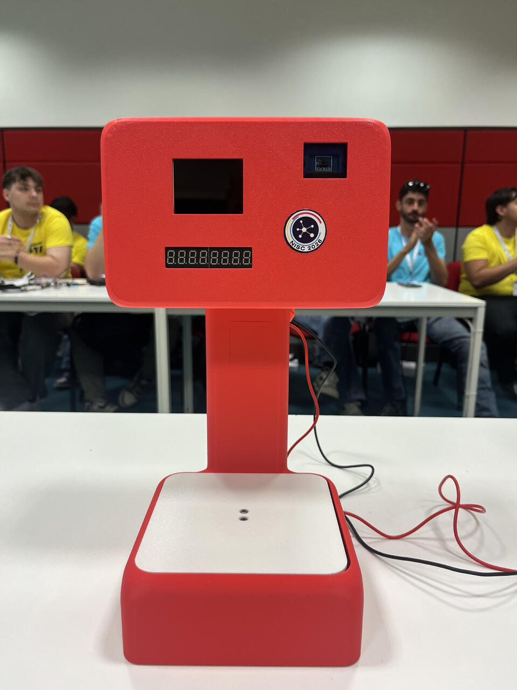
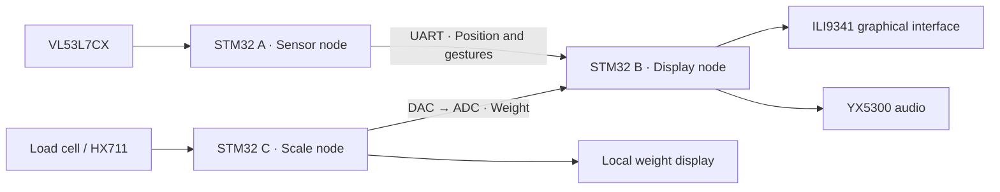
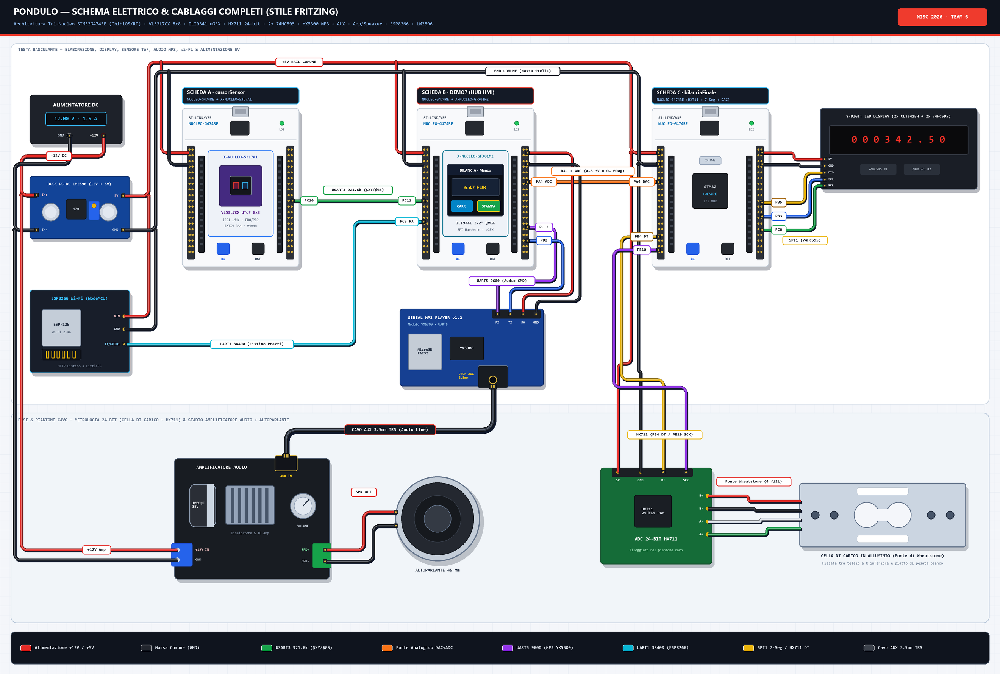

# PONDULO
 
**Touchless interface and weighing system on STM32**

One of the three winning projects at **NISC 2026 — NeaPolis Innovation Summer Campus**, associated with **STMicroelectronics**. Developed by **Team 6**.

[](https://pondulo.vincenzonet.it)

> **Esplora PONDULO in 3D interattivo** (modello CAD Fusion 360, vista Raggi X, fascio ToF 8×8, esploso completo dei componenti e video demo): **[pondulo.vincenzonet.it](https://pondulo.vincenzonet.it)**

<p align="center">
  
</p>

<p align="center"><sub>The PONDULO prototype at NISC 2026.</sub></p>

[Panoramica in italiano](docs/README.it.md) · [Architecture](docs/ARCHITECTURE.md) · [Hardware](docs/HARDWARE.md) · [Build instructions](docs/BUILD.md)

## Overview

PONDULO combines contact-free interaction with physical weighing. A multi-zone Time-of-Flight sensor tracks the operator's hand; the firmware converts its position and movement into an on-screen cursor, gestures and selections. Three STM32 controllers divide sensing, graphical interaction and weight acquisition.

The main demonstration follows a retail workflow: select a product, acquire its weight, specify the quantity, and prepare a cart or an on-screen receipt. A separate clinical demonstration explores gesture navigation using sample patient information.

## Technical scope

| Subsystem | Implementation |
|---|---|
| Hand tracking | VL53L7CX ToF sensor, weighted spatial centroid and fixed-point filtering |
| Interaction | Directional and proximity gestures; selection by a 1.5-second dwell |
| Graphical interface | 320 × 240 ILI9341 display, uGFX, incremental redraws and cursor background restoration |
| Weighing | HX711 load-cell acquisition, startup tare, calibration, filtering and local 8-digit display |
| Inter-board communication | UART for cursor and gesture messages; 12-bit DAC-to-ADC link for weight |
| Audio | YX5300 serial MP3 module with context-dependent feedback |
| Runtime | Embedded C and ChibiOS threads, interrupts, mutexes and mailboxes |

An additional ESP8266 prototype provides a web price editor, LittleFS persistence and UART transmission to a standalone STM32 receiver. This subsystem is a separate test bench; its integration into the main display firmware remains future work.

## System architecture



The sensor node separates ranging acquisition from pointer updates. The display node receives pointer state and gesture events, updates the interface and reads the analog weight signal. The scale node handles the load cell independently, including tare and calibration.

### Wiring diagram

<p align="center">
  <a href="docs/assets/pondulo-wiring-diagram.png">
    
  </a>
</p>

<p align="center"><sub>Complete hardware wiring diagram (click to open full resolution · 2640 × 1780 PNG).</sub></p>

See [the architecture guide](docs/ARCHITECTURE.md) for protocols, thread responsibilities and implementation boundaries, and [the hardware guide](docs/HARDWARE.md) for connections.

## Source layout

```text
firmware/
├── sensor-node/     ToF acquisition, cursor processing and gesture detection
├── display-node/    Interface, serial input, weight ADC and audio
├── scale-node/      HX711, calibration, local display and weight DAC
├── price-bridge/    Standalone STM32 price receiver
└── esp8266/         Web price editor and flash storage
```

Application sources retain the competition implementation. Repository preparation reorganized the directories, made external dependency paths configurable and updated host tests to match the current interface.

## Build and verification

Run the native software tests with Python 3 and a C11 compiler:

```sh
git clone https://github.com/EmanuelChirico/Pondulo.git
cd Pondulo
python3 scripts/test_host.py
```

**Eight host-test executables pass locally.** They cover cursor smoothing, gesture protocols, dwell/focus behaviour, audio events, JSON parsing, a cart arithmetic model, storage fixtures and price-message validation. The [GitHub Actions workflow](https://github.com/EmanuelChirico/Pondulo/actions/workflows/host-tests.yml) runs the same command.

Embedded builds require the compatible ChibiOS 21.11 and uGFX trees, plus the Arm GNU toolchain. These dependencies were absent from the supplied snapshot; a full embedded rebuild and new hardware measurements have not been verified during repository preparation.

- [Build guide](docs/BUILD.md): dependencies and per-board commands.
- [Validation record](docs/VALIDATION.md): test coverage and verification limits.
- [Engineering review](docs/REVIEW.md): implementation status and remaining work.

The project is a competition prototype. Clinical screens use sample data, receipts are displayed on screen, and the storage module uses fixtures rather than a physical SD driver.

## Credits

Developed by **Team 6** for **NISC 2026**. Repository maintained by [Emanuel Chirico](https://github.com/EmanuelChirico).

Thanks to all **Team 6 collaborators** for their contributions to the project.
See the [repository contributors](https://github.com/EmanuelChirico/Pondulo/graphs/contributors)
for contributions recorded in Git; team participation also includes work outside GitHub.

[Team and event context](docs/CREDITS.md) · [Third-party software notices](THIRD_PARTY_NOTICES.md)

The repository's existing [Eclipse Public License 2.0](LICENSE) is retained.
Original copyright notices and third-party licensing context are preserved in
[THIRD_PARTY_NOTICES.md](THIRD_PARTY_NOTICES.md). 


